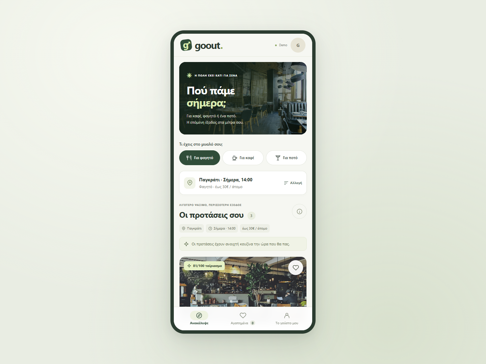

# GoOut

Η έξοδος που σου ταιριάζει: μια εφαρμογή κινητού που προτείνει πού να πας για **φαγητό, καφέ ή ποτό**, οποιαδήποτε ώρα της ημέρας. Διαδραστικό mockup για το **HW 1: Interactive Mockup**, στο μάθημα Αναλυτική Διαδικτύου.

## Εκκίνηση

Κατέβασε το repository (**Code → Download ZIP**), αποσυμπίεσέ το και άνοιξε το **`index.html`** στον browser. Δεν χρειάζεται εγκατάσταση. [Οδηγίες σε 3 βήματα](INSTRUCTIONS.md).

## Τι περιλαμβάνει

- Προβολή εφαρμογής κινητού με κάτω πλοήγηση και πλαίσιο τηλεφώνου στον υπολογιστή.
- Επιλογές για φαγητό, καφέ και ποτό, με περιοχή, ημέρα, ώρα και budget.
- Ξεχωριστά απαραίτητα χαρακτηριστικά και επιπλέον προτιμήσεις.
- Κατάταξη προτάσεων, εξηγήσεις και σαφής αναφορά προτιμήσεων που δεν καλύπτονται.
- Έλεγχο ωραρίου καταστήματος, κουζίνας και live μουσικής, ακόμη και μετά τα μεσάνυχτα.
- Αγαπημένα, αξιολογήσεις και τοπικό προφίλ προτιμήσεων.



## Σύστημα συστάσεων και δεδομένα

Ο κατάλογος περιέχει **12 φανταστικά μαγαζιά**. Η εφαρμογή αποκλείει όσα δεν καλύπτουν τους απαραίτητους περιορισμούς και κατατάσσει τα υπόλοιπα βάσει προτιμήσεων, κόστους και προηγούμενων αξιολογήσεων.

Το demo χρησιμοποιεί κανόνες και σταθμισμένη βαθμολόγηση. Το σκορ ταιριάσματος δεν είναι πιθανότητα, πραγματική αξιολόγηση καταστήματος ή αποτέλεσμα εκπαιδευμένου μοντέλου. Τα ωράρια επαναλαμβάνονται κάθε ημέρα· δεν υπάρχουν ζωντανά δεδομένα, κρατήσεις ή πραγματικός λογαριασμός. Αγαπημένα, επιλογές και feedback αποθηκεύονται τοπικά με `localStorage`, όπου επιτρέπεται.

Οι φωτογραφίες είναι ενδεικτικές, αποθηκευμένες τοπικά, και δεν απεικονίζουν τα φανταστικά μαγαζιά.

## Αρχεία

| Αρχείο | Χρήση |
| --- | --- |
| `index.html`, `styles.css` | Οθόνες και εμφάνιση εφαρμογής κινητού |
| `app.js` | Πλοήγηση, φίλτρα, λεπτομέρειες και τοπική αποθήκευση |
| `data.js` | Ενδεικτικός κατάλογος καταστημάτων |
| `recommender.js` | Φιλτράρισμα και κατάταξη συστάσεων |
| `recommender.test.cjs` | Έλεγχοι της λογικής συστάσεων |
| `assets/` | Φωτογραφίες και εικονίδιο |
| [INSTRUCTIONS.md](INSTRUCTIONS.md) | Οδηγίες εκκίνησης |
| [docs/CONCEPT.md](docs/CONCEPT.md) | Περιγραφή ιδέας και ροής |

## Έλεγχοι

Με Node.js, από το root του repository:

```powershell
node --test recommender.test.cjs
```

Η λογική καλύπτεται από 13 tests για ωράρια, μεσάνυχτα, διαθεσιμότητα κουζίνας και live μουσικής, απαραίτητα χαρακτηριστικά, προτιμήσεις και feedback. Η διεπαφή ελέγχθηκε σε Chromium μέσω τοπικού HTTP server, σε πλάτη 320, 390, 430 και 1440px, με πλοήγηση πληκτρολογίου και διατήρηση αγαπημένων μετά από ανανέωση. Δεν εμφανίστηκαν σφάλματα στην κονσόλα ή οριζόντια υπερχείλιση.

Η άμεση εκκίνηση του HTML δεν ελέγχθηκε αυτοματοποιημένα· οι δοκιμές browser έγιναν μέσω τοπικού HTTP server.

## Χρήση AI

Χρησιμοποιήθηκε AI για τον σχεδιασμό, τον κώδικα, τα ενδεικτικά δεδομένα, τους ελέγχους και την τεκμηρίωση. Κατά τη χρήση του demo δεν καλείται εξωτερικό μοντέλο AI. Η εφαρμογή μπορεί να εξελιχθεί με πραγματικά δεδομένα και σύστημα συστάσεων που αξιοποιεί αξιολογήσεις χρηστών.
